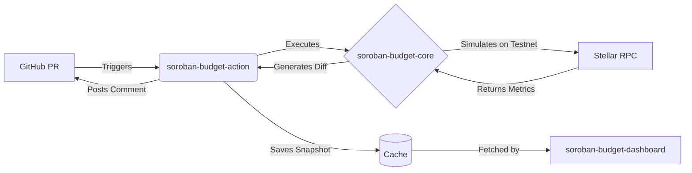

# Welcome to BudgetGate

BudgetGate is an end-to-end telemetry and CI/CD platform designed specifically for the **Soroban Smart Contract Ecosystem**. 

When building complex smart contracts, developers often introduce subtle regressions (like inefficient loops or large memory allocations) that push the contract's execution cost beyond the strict limits of the Stellar network (such as the 100M CPU instruction cap). BudgetGate catches these spikes *before* they are merged into the main branch.

## How it works

## The Three Pillars

BudgetGate is divided into three interconnected repositories:

1. **[Core CLI](/core/)**: The engine that parses XDR and interrogates the Soroban RPC.
2. **[GitHub Action](/action/)**: The automation layer that runs the CLI in CI and caches the results.
3. **[Dashboard](/dashboard/)**: The visual frontend for monitoring historical telemetry data.
